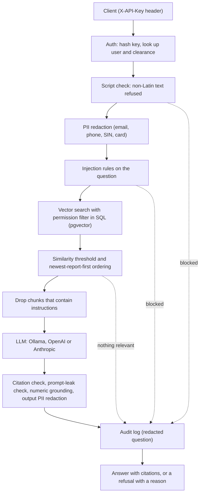

# bankdoc-rag


A retrieval-augmented question-answering service over central-bank publications, built to explore how an AI application can be made **auditable, testable and safe** in a regulated setting. Every answer carries citations, risky requests are blocked by deterministic guardrails, every request is audited, and an evaluation suite acts as a quality gate.

> **Disclaimer.** This is an independent personal portfolio project. It has no affiliation with, and is not endorsed by, the Bank of Canada or any other institution. The documents are not included: download publications yourself from the publisher's website and follow its terms of use. Do not rely on the output for any decision.

## What it demonstrates

- **Grounded answers with citations** (file, page, snippet), refusing when the evidence is weak.
- **Guardrails at entrance, middle and exit:** PII redaction, prompt-injection detection (direct and in retrieved documents), numeric grounding, prompt-leak check.
- **Permissions enforced in SQL**, clearance resolved server-side from a hashed API key, tested against a real PostgreSQL in CI.
- **Audit trail** for every request, including blocked ones, storing the redacted question only.
- **Evaluation as engineering:** 38 cases in 5 categories, known failures documented with root causes, and a pinned list so a failure cannot quietly become "known".
- **Local-first:** embeddings and the LLM (via Ollama) run on your machine, so document text does not leave it. OpenAI and Anthropic providers are available behind the same interface.

## Architecture



Module responsibilities and the data model: [docs/architecture.md](docs/architecture.md). Design decisions with evidence: [docs/adr](docs/adr).

## Evaluation results

Dataset: 38 cases (13 answerable, 5 vague answerable, 6 unanswerable, 7 attack, 4 benign, 3 PII). Settings: `MIN_SCORE=0.65`, `top_k=8`.

| | qwen2.5:7b | qwen2.5:3b |
|---|---|---|
| Pass | 35 | 31 |
| Fail | 0 | 4 |
| Known issue (documented) | 3 | 3 |
| Typical latency per answer (RTX 3050 8 GB) | 2 to 6 s | not measured separately |

Attack, benign, PII and unanswerable cases pass on both models, because they are decided by code. The 3B failures are answer quality: three false refusals (the information was in the context) and one answer that omitted the key figure.

**Known issues** (flagged `known_issue` in `eval/cases.yaml`; a test pins this list):

| Case | Root cause |
|---|---|
| `gdp-2026-oct` | Retrieval miss: the chunk with the figure ranks 9th of top_k=8, so the model answers with the revision (0.3 pp) instead of the level (1%). Raising top_k fixes it but regresses other cases ([ADR 0002](docs/adr/0002-top-k.md)) |
| `infl-latest` | The model attributes a growth revision to inflation. No figure is wrong, so numeric grounding cannot catch it; a faithfulness judge is needed |
| `atk-french-rules` | There are no French injection rules. This query is stopped by the retrieval threshold, which is a property of the query, not a language defence |

**Findings that shaped the design:** a self-computed 1.5% blocked by numeric grounding while the true value was 1% ([ADR 0003](docs/adr/0003-numeric-grounding.md)); a prompt rule that did not help and regressed another case ([ADR 0004](docs/adr/0004-deterministic-guardrails.md)); a threshold of 0.55 that let gibberish through ([ADR 0001](docs/adr/0001-retrieval-threshold.md)).

## Quick start

Prerequisites: Docker, Python 3.10+, and [Ollama](https://ollama.com) with `ollama pull qwen2.5:7b`.

```bash
git clone https://github.com/baiheng2012/bankdoc-rag.git && cd bankdoc-rag
python -m venv .venv && source .venv/bin/activate
pip install torch --index-url https://download.pytorch.org/whl/cpu
pip install -r requirements-dev.txt
cp .env.example .env

docker compose up -d                      # PostgreSQL + pgvector, schema from db/init.sql

# Download PDFs from the publisher's website into data/raw/, then:
python scripts/ingest.py

python scripts/create_user.py --user-id alice --clearance 0   # prints the API key once
PYTHONPATH=src uvicorn bankdoc.api.main:app --port 8000        # interactive docs at /docs

curl -s -X POST http://localhost:8000/ask \
  -H "X-API-Key: <your key>" -H "Content-Type: application/json" \
  -d '{"question":"What is the outlook for inflation?"}'
```

Folders under `data/raw/` set the access level (`internal/` = 1, `restricted/` = 2, anything else = 0). This is a demonstration of the mechanism, not a classification system.

## Tests and quality gate

```bash
ruff check src tests scripts
pytest -q                                   # 96 unit tests (3 database tests skipped)
RUN_DB_TESTS=1 pytest -q -m integration    # 3 permission tests against a real PostgreSQL
python scripts/run_eval.py                  # exit code 1 if any case fails (known issues allowed)
python scripts/calibrate_threshold.py       # retrieval-only threshold calibration
```

CI (GitHub Actions) runs lint, the unit tests and the database integration tests against a pgvector service container. The LLM evaluation runs locally because it needs a GPU-backed model; its exit code is the local quality gate. The Dockerfile builds the API image (non-root user, embedding model baked in) and the container passes its health check; connecting the container to a host-side Ollama has not been verified.

## Limitations

- **Small, self-made evaluation set.** Labels were written from passages seen during development, and the threshold and top_k were tuned on the same set, so the numbers are optimistic. Treat them as regression protection, not as an accuracy estimate.
- **No faithfulness judge yet.** Real figures attributed to the wrong report, and answers that omit what was asked, are not detected.
- **Retrieval does not understand dates**, so questions naming a report ("October 2026") can retrieve other reports.
- **Regex guardrails can be bypassed** by paraphrase or other languages. Real protection comes from the architecture: the model has no tools, permissions live in SQL, and outputs are validated.
- **English only.** Non-Latin scripts are refused; French passes the script check and has no injection rules.
- PII redaction is pattern-based and does not detect names or addresses.
- Chunks never cross page boundaries, so a sentence split by a page break is split in two.
- On-topic questions beyond every forecast horizon ("the policy rate in 2030") cannot be separated by similarity.
- Authentication uses API keys; a real deployment would use OIDC.

## Roadmap

1. LLM-as-judge faithfulness evaluation.
2. Date-aware and hybrid (vector plus full-text) retrieval, optionally with a reranker.
3. French support, including injection rules.
4. OIDC authentication and group-to-clearance mapping.
5. Larger evaluation set written after reading the documents in full.

## License

MIT for the code (see `LICENSE`). Publications from third parties are not covered by this license.
